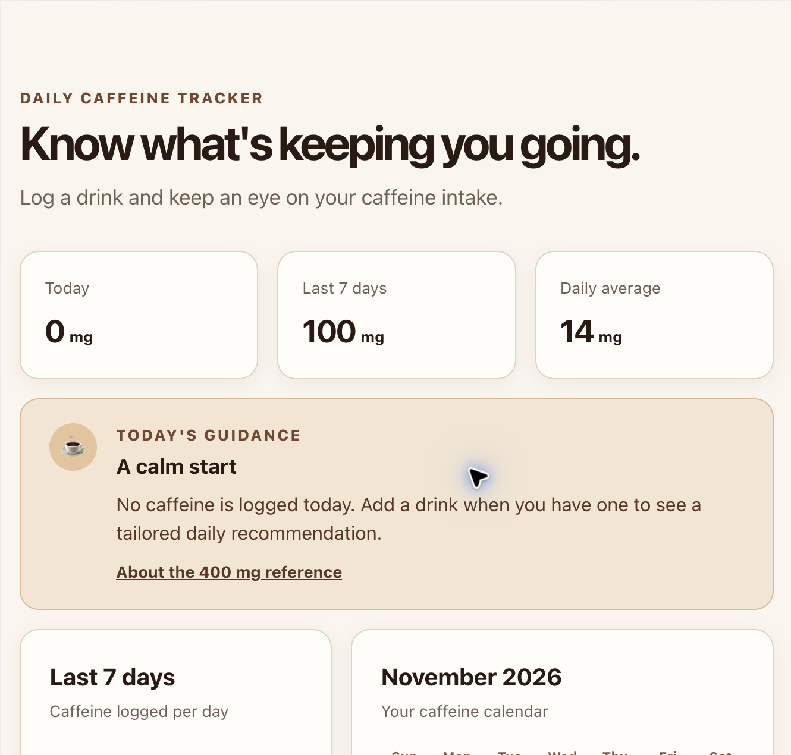

# ☕ Caffeine Tracker

A small full-stack application for recording caffeine consumption and reviewing daily and weekly intake. It uses a React frontend and a FastAPI backend.



## What it does

The backend currently supports:

- Logging a drink with its name, caffeine amount (in milligrams), and an optional timestamp
- Attaching an optional JPEG, PNG, or WebP photo to a drink
- Listing all recorded drinks
- Calculating today's caffeine total
- Calculating the total caffeine consumed in the past seven days and the corresponding daily average

Drink data is kept in memory, so it is cleared whenever the backend restarts. Uploaded photos are stored locally in `backend/uploads/` and are not committed to Git.

## Project structure

```text
caffeine-tracker/
├── backend/              # FastAPI API
│   ├── main.py
│   └── requirements.txt
└── frontend/             # React + Vite application
    └── src/
```

## API

Run the backend locally at `http://localhost:8000`.

| Method | Endpoint | Description |
| --- | --- | --- |
| `GET` | `/drinks` | Return all logged drinks. |
| `POST` | `/drinks` | Create a drink entry. |
| `POST` | `/uploads` | Upload a JPEG, PNG, or WebP drink photo (up to 5 MB). |
| `GET` | `/summary` | Return caffeine totals for today and the last seven days. |

### Create a drink

```bash
curl -X POST http://localhost:8000/drinks \
  -H 'Content-Type: application/json' \
  -d '{"name":"Coffee","caffeine_mg":95}'
```

The timestamp is optional. When omitted, the API records the current UTC time.

Example response:

```json
{
  "name": "Coffee",
  "caffeine_mg": 95,
  "timestamp": "2026-11-16T09:00:00Z"
}
```

### Get a summary

```json
{
  "today_total": 95,
  "week_total": 95,
  "avg_daily": 13.57
}
```

## Run locally

### Backend

```bash
cd caffeine-tracker/backend
python -m venv venv
source venv/bin/activate
pip install -r requirements.txt
uvicorn main:app --reload
```

Interactive API documentation is available at `http://localhost:8000/docs`.

### Frontend

```bash
cd caffeine-tracker/frontend
npm install
npm run dev
```

The included frontend is currently a starter UI that still references a fruit-management example. It needs to be updated to call the caffeine endpoints above before it can be used as the tracker interface.

## Planned improvements

- Replace in-memory storage with SQLite or PostgreSQL
- Build the drink-entry, history, and summary screens in the React frontend
- Add date filtering and charts
- Add personalized caffeine-use insights

